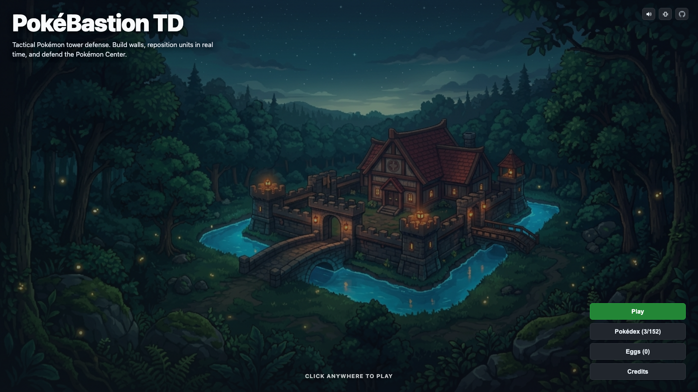
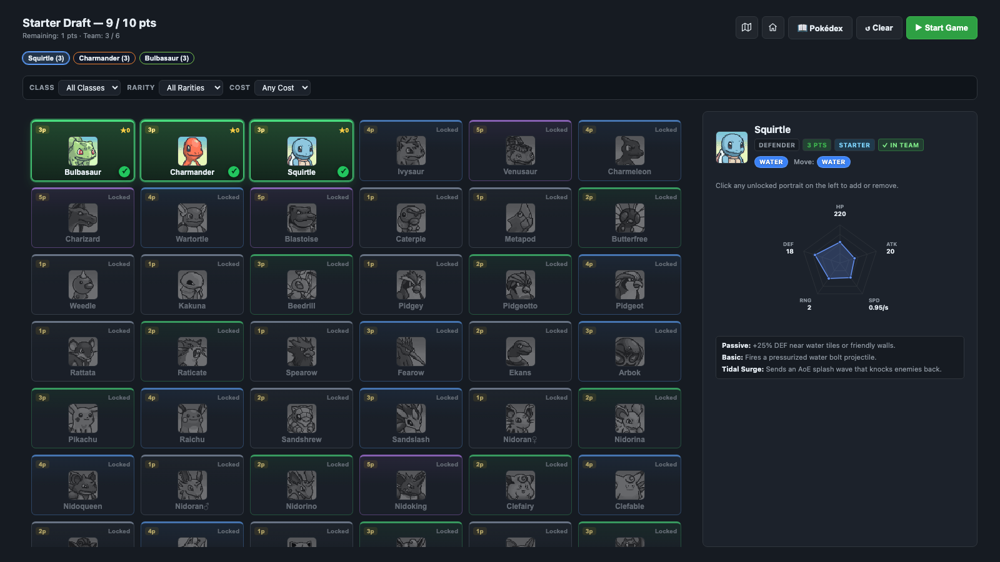
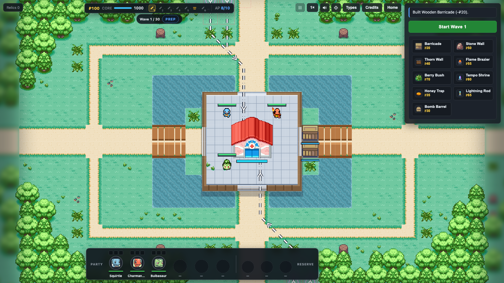
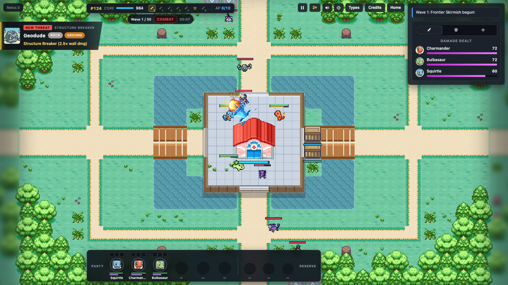
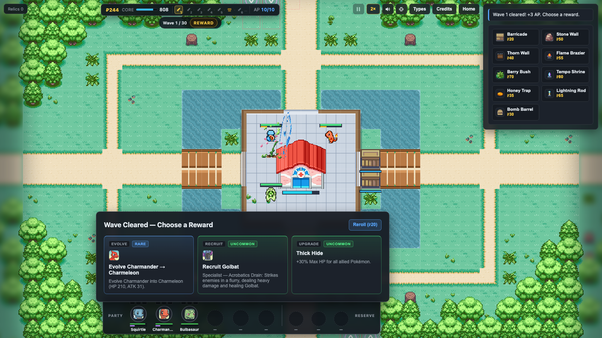
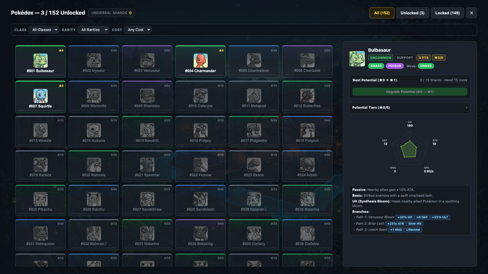

# PokéBastion TD

An open-map, real-time roguelike Pokémon tower defense game inspired by _The Last Spell_, _Arknights_, and _Path to Nowhere_.

Instead of fixed enemy lanes, wild Pokémon dynamically pathfind across a `28×18` battlefield toward your central Pokémon Center. Build walls and traps to reshape their routes, draft your squad, reposition units mid-fight with Action Points, and unleash manual or auto-cast Ultimates across 20–50 wave runs.

**[Play Now on GitHub Pages](https://phanturne.github.io/pokebastion/)**



---

## Features

- **Open-Map Dynamic Pathfinding:** Enemies route around your walls in real time—with live dashed path previews during prep so you can sculpt chokepoints before every wave.
- **152 Playable Pokémon & 3-Way Specializations:** Draft a starting squad within a 10-point budget (starting with Bulbasaur, Charmander, and Squirtle), recruit more between waves, evolve units, and unlock 3 distinct specialization branches per species.
- **Real-Time Tactical Repositioning:** Pokémon auto-attack in range, while you spend shared **Action Points (AP)** (`1 AP` per move in combat, `0 AP` in prep) to reposition them around threats and trigger **Ultimates** at the right moment.
- **9 Defensive Structures & Traps:** Build Barricades, Stone Walls, Thorn Walls, Flame Braziers, Berry Bushes, Tempo Shrines, Honey Traps, Lightning Rods, and Bomb Barrels—freely movable during prep, repairable, or sellable for a `70%` refund.
- **24 Held Items & Roguelike Relics:** Equip up to 3 held items per Pokémon (`HELD_ITEM_CATALOG`), draft team-wide class/subclass upgrades, and collect global artifacts (including structure-buffing relics like _Fortification Core_).
- **4 Maps & 4 Difficulty Modes:** Battle across distinct maps from `Easy` (20 waves) to `Expert` (50 waves), facing ground, burrowing (`Diglett`), flying (`Zubat`), and wall-breaker (`Geodude`) threats plus boss encounters.
- **Meta-Progression:** Earn **Species Shards**, **Universal Shards**, **Eggs** (Common, Rare, Master), and **Achievements** across runs to unlock new Pokémon in the Pokédex and upgrade their **Potential (`★0–★5`)**.

---

## Screenshots

|                Home Screen                |                Starter Draft                 |
| :---------------------------------------: | :------------------------------------------: |
|  |  |

|     Prep Phase & Live Path Previews      |            Wave Combat & Live DPS            |
| :--------------------------------------: | :------------------------------------------: |
|  |  |

|              Post-Wave Rewards               |       Pokédex & Potential Upgrades       |
| :------------------------------------------: | :--------------------------------------: |
|  |  |

---

## How to Play

1. **Draft Your Squad:** Pick a map and difficulty, then spend your 10-point draft budget to assemble your starting team.
2. **Preparation Phase (`PREP`):**
   - Place, move, repair, or sell structures to funnel enemies into kill zones.
   - Reposition your Pokémon freely (`0 AP`), heal/revive injured units, equip held items, or swap with up to `3` reserve units.
   - Watch the live dashed enemy path previews update as you build, then hit **Start Wave**.
3. **Combat Phase (`COMBAT`):**
   - Pokémon attack automatically. Click a unit and click any reachable tile to reposition (`1 AP`).
   - Trigger **Ultimates** manually (or let auto-ult handle them) and toggle `1×` / `2×` speed or pause anytime.
4. **Rewards & Shop (`REWARD` / `SHOP`):**
   - Pick 1 of 3 roguelike rewards after waves (new recruits, evolutions, class upgrades, or artifacts) and visit the shop every 5th wave.
5. **Shortcuts:** Press **`Esc`** or **right-click** on the battlefield to cancel active placement, unit selection, or Ultimate aiming.

---

## Run Locally

**Prerequisites:** Node.js 22+ and npm.

```bash
npm install
npm run dev       # Start local dev server at http://localhost:5173
```

### Scripts

| Command                | Description                                               |
| :--------------------- | :-------------------------------------------------------- |
| `npm run dev`          | Start Vite development server                             |
| `npm run build`        | Type-check (`tsc`) and build production bundle to `dist/` |
| `npm run preview`      | Preview the production `dist/` build locally              |
| `npm test`             | Run Vitest unit & data-integrity tests                    |
| `npm run test:e2e`     | Run Playwright browser end-to-end tests                   |
| `npm run check:bundle` | Check production bundle size limits                       |
| `npm run lint`         | Run ESLint across the repository                          |
| `npm run format:check` | Check Prettier formatting                                 |

---

## Documentation & Credits

- **New to the codebase?** Start with the [Developer Onboarding Guide](docs/developer-guide.md).
- **Architecture & AI agent rules:** [docs/architecture.md](docs/architecture.md) · [AGENTS.md](AGENTS.md)
- **Full Game Design Document:** [docs/gdd.md](docs/gdd.md)
- **Asset & sprite credits:** [CREDITS.md](CREDITS.md)
