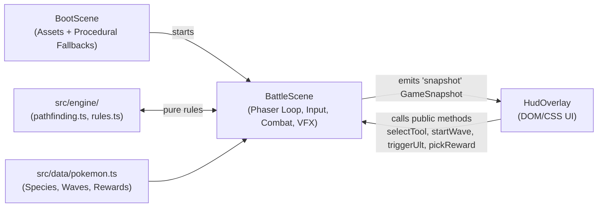

# PokéBastion TD — Architecture Overview

## Tech Stack

- **Runtime & Rendering:** Phaser 3 (`^3.90.0`), TypeScript (`^5.7.2`), Vite (`^6.2.0`)
- **UI Overlay:** Vanilla DOM/CSS (`src/ui/HudOverlay.ts` + `index.html`) subscribing to Phaser game events
- **Testing & Quality:** Vitest (`^5.1.0`), ESLint 10 (`eslint.config.js`), Prettier (`.prettierrc`), Husky + `lint-staged`
- **Deployment:** Static `dist/` bundle deployed to GitHub Pages via `.github/workflows/deploy.yml`

---

## Directory Structure

```
pokebastion/
├── .github/workflows/deploy.yml  # CI build & GitHub Pages deploy on main/master
├── .husky/pre-commit             # Runs lint-staged (ESLint + Prettier) on commit
├── docs/
│   ├── architecture.md           # System architecture & engineering notes
│   ├── gdd.md                    # Full Game Design Document + prototype status
│   ├── prototype-spec.md         # Original prototype specification
│   └── placeholders.md           # Asset placeholder tracking
├── public/assets/
│   ├── pokemon/                  # PMDCollab 8-dir spritesheets + manifest.json
│   ├── vfx/                      # PVFX Foundry spritesheets + manifest.json
│   ├── structures/               # Core, walls, berry bush, barrel, trees, props
│   └── tiles/                    # ekat-route224.png (16×16 sub-tiles)
├── scripts/
│   └── sync-assets.mjs           # Generates pokemon/manifest.json & vfx/manifest.json
├── src/
│   ├── types.ts                  # Domain types & grid constants (28×18 @ 32px)
│   ├── main.ts                   # Phaser.Scale.FIT bootstrap (896×576) + HudOverlay
│   ├── data/
│   │   └── pokemon.ts            # 10 Pokémon (3 branches each), 3 held items, 10 enemies, 4 structures, 8 rewards, 10 waves
│   ├── engine/                   # Pure TypeScript rules (zero Phaser imports)
│   │   ├── pathfinding.ts        # 8-dir A* (enemy ground/burrow/fly + unit walking), wall fallback, portals, no-build rules
│   │   └── rules.ts              # AP movement cost, stat/artifact math, economy, reward rolls
│   ├── scenes/
│   │   ├── BootScene.ts          # Preloads tiles, structures, manifests + procedural fallbacks
│   │   └── BattleScene.ts        # Grid rendering, input, live A* previews, combat loop, VFX
│   └── ui/
│       └── HudOverlay.ts         # Top bar, side panel, modals driven by 'snapshot' events
└── tests/
    ├── dataIntegrity.test.ts     # Validates species/VFX keys against asset manifests
    ├── pathfinding.test.ts       # Tests 8-dir A*, unit walking paths, burrow/fly, nearest-wall, no-build buffers
    └── rules.test.ts             # Tests AP movement cost, stat/artifact math, economy, reward pool
```

---

## Data & Control Flow

The UI (`HudOverlay`) and simulation (`BattleScene`) communicate through a unidirectional **snapshot-and-command** loop:



- **Canvas & Viewport:** `src/main.ts` boots Phaser at `896×576` (`28×18` tiles at `32px`, `pixelArt: true`) using `Phaser.Scale.FIT` + `CENTER_BOTH` inside `#phaser-host`, with a `ResizeObserver` refreshing scale on layout changes.
- **Asset Pipeline:** `BootScene` reads `public/assets/pokemon/manifest.json` and `public/assets/vfx/manifest.json` (generated by `scripts/sync-assets.mjs`), registers 8-directional `Walk` / `Idle` / `Attack` animations (`pmd:<id>:<anim>`), and generates procedural fallback textures if any sheet is missing.
- **Pathfinding & Live Previews:** `src/engine/pathfinding.ts` implements 8-directional A* (`findPath`) supporting `ground`, `burrow` (Diglett bypasses walls), and `fly` (Zubat bypasses walls & water), plus `findUnitPath` for player Pokémon (avoids `water`, `tree`, `core`, and active structures while passing through allies). During `PREP`, `BattleScene` computes live dashed path previews from active `SpawnPortal`s to the `2×2` `CORE_CELLS`, including speculative previews when hovering a wall tool.
- **Unit Movement (`PREP` vs `COMBAT`):** `PREP` repositioning is instant and free (`0 AP`). During `COMBAT`, ordering a unit to any reachable tile costs `1 AP` (validated via `findUnitPath` before spending AP) and walks tile-by-tile at `2.5 + moveRange * 1.5` tiles/s (`moveRange` includes `swift_boots` and branch `moveRangeBonus`). Walking units reserve their destination `moveTarget`, remain targetable while pausing basic attacks/auto-ult, support mid-move redirects from their current tile, and clear movement state on faint or wave end.

---

## Engineering Guidelines

1. **Keep `src/engine/` framework-free:** New mechanics (held items, branching evolutions, new structures, wave budget generators) belong as pure functions in `src/engine/` with Vitest unit tests before wiring visuals in `BattleScene`.
2. **Validate data against manifests:** All `public/assets/` sprites and manifests are already committed in the repository (`scripts/sync-assets.mjs` expects local external asset packs and is only for regenerating manifests). When editing `src/data/pokemon.ts`, run `npm test` so `tests/dataIntegrity.test.ts` catches missing manifest entries.
3. **Subsystems extraction seam:** `BattleScene.ts` (~3,500 lines) currently owns terrain/prop rendering, pointer input, unit/enemy combat AI, wave spawning, and VFX. When expanding to multi-map runs or boss encounters, split `WaveDirector`, `CombatSystem`, and `GridRenderer` out of `BattleScene` over a shared `RunState` object.
