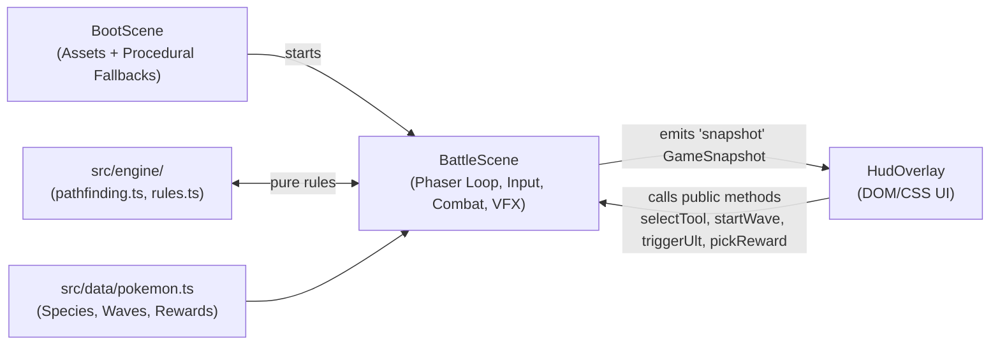

# PokéBastion TD — Architecture Overview

## Tech Stack

- **Runtime & Rendering:** Phaser 3 (`^3.90.0`), TypeScript (`^5.7.2`), Vite (`^6.2.0`)
- **UI Overlay:** Vanilla DOM/CSS (`src/ui/HudOverlay.ts`, `src/styles.css`, `index.html`) subscribing to Phaser game events
- **Testing & Quality:** Vitest (`^5.1.0`), Playwright (`^1.65.1`), ESLint 10 (`eslint.config.js`), Prettier (`.prettierrc`), Husky + `lint-staged`
- **Deployment:** Static `dist/` bundle deployed to GitHub Pages via `.github/workflows/deploy.yml`

---

## Directory Structure

```
pokebastion/
├── .github/workflows/deploy.yml  # CI build & GitHub Pages deploy on main/master
├── .husky/pre-commit             # Runs lint-staged (ESLint + Prettier) on commit
├── docs/
│   ├── agent-guidelines.md       # Agent conventions & workflow rules
│   ├── architecture.md           # System architecture & engineering notes
│   ├── developer-guide.md        # Developer onboarding guide
│   ├── gdd.md                    # Full Game Design Document + prototype status
│   ├── placeholders.md           # Asset placeholder tracking
│   └── prototype-spec.md         # Original prototype specification
├── e2e/
│   ├── game.spec.ts              # Playwright end-to-end gameplay tests
│   └── perf.spec.ts              # Playwright frame-time & performance checks
├── public/assets/
│   ├── pokemon/                  # PMDCollab 8-dir spritesheets + manifest.json
│   ├── vfx/                      # PVFX Foundry spritesheets + manifest.json
│   ├── structures/               # Core, walls, berry bush, barrel, trees, props
│   └── tiles/                    # ekat-route224.png (16×16 sub-tiles)
├── scripts/
│   ├── check-bundle-size.mjs     # Verifies dist/ bundle size against budget
│   └── sync-assets.mjs           # Generates pokemon/manifest.json & vfx/manifest.json
├── src/
│   ├── types.ts                  # Domain types & grid constants (28×18 @ 32px)
│   ├── main.ts                   # Phaser.Scale.RESIZE bootstrap (896×576) + HudOverlay
│   ├── styles.css                # HUD, modal, and layout styling
│   ├── audio/
│   │   └── sfx.ts                # Procedural Web Audio SFX synthesizer
│   ├── data/
│   │   ├── classes.ts            # 6 Pokémon classes, 18 subclasses, class/subclass upgrades
│   │   ├── evolutions.ts         # Linear & branching evolution chains (EVOLUTION_NEXT)
│   │   ├── gen1.ts               # 151 GEN1_POKEMON + 151 GEN1_ENEMIES
│   │   ├── items.ts              # 24 HELD_ITEM_CATALOG + 17 ARTIFACT_CATALOG entries
│   │   ├── maps.ts               # 4 playable maps (MapSpec), terrain, difficulty, wave themes
│   │   ├── pokemon.ts            # 152 POKEMON_SPECIES (GEN1 + Lucario), 27 ENEMY_SPECIES, 9 structures, 7 base rewards, 10 base waves
│   │   └── waves.ts              # RUN_DIFFICULTIES (20–50 waves), MAP_WAVE_OVERRIDES, getWavesForRun
│   ├── engine/                   # Pure TypeScript rules (zero Phaser imports)
│   │   ├── combat.ts             # Damage, armor/DEF, crit, AoE/status helpers
│   │   ├── kits.ts               # Species passive kits, auras, ultimates, and HAZARD_SPECS
│   │   ├── pathfinding.ts        # 8-dir A* (ground/burrow/fly + unit walking), wall fallback, portals, no-build rules
│   │   ├── progression.ts        # Shard costs, Potential ★0–★5, Egg rates, Achievements
│   │   ├── rules.ts              # AP movement cost, stat/artifact math, economy, reward rolls
│   │   ├── save.ts               # localStorage PlayerSave serialization, egg hatching, victory rewards
│   │   └── typeChart.ts          # 18-type elemental effectiveness chart
│   ├── scenes/
│   │   ├── BootScene.ts          # Preloads tiles, structures, manifests + procedural fallbacks
│   │   ├── BattleScene.ts        # Grid rendering, input, live A* previews, combat loop, VFX
│   │   └── terrainRenderer.ts    # Tilemap & environmental prop rendering helpers
│   └── ui/
│       ├── HudOverlay.ts         # Main HUD controller, shortcuts, snapshot subscription
│       ├── hudModals.ts          # Map/Difficulty Select, Draft, Pokédex, Eggs, Shop, Rewards, Victory/Defeat modals
│       ├── hudShared.ts          # Shared HTML escaping and UI formatting helpers
│       └── hudSidePanel.ts       # Side panel (squad roster, unit inspector, structure tools, artifacts)
└── tests/
    ├── classes.test.ts           # Tests class/subclass definitions and upgrades
    ├── combat.test.ts            # Tests pure combat damage, crit, and status math
    ├── dataIntegrity.test.ts     # Validates species/VFX keys against asset manifests
    ├── gen1.test.ts              # Tests Gen 1 species and enemy catalog integrity
    ├── items.test.ts             # Tests held item and artifact catalogs
    ├── kits.test.ts              # Tests species kits and hazard specs
    ├── maps.test.ts              # Tests map layouts and terrain rules
    ├── pathfinding.test.ts       # Tests 8-dir A*, unit walking paths, burrow/fly, nearest-wall, no-build buffers
    ├── perf.test.ts              # Engine performance benchmarks
    ├── progression.test.ts       # Tests shard, Potential ★0–★5, egg, and achievement logic
    ├── rules.test.ts             # Tests AP movement cost, stat/artifact math, economy, reward pool
    ├── save.test.ts              # Tests PlayerSave persistence, egg hatching, and victory rewards
    ├── typeChart.test.ts         # Tests 18-type effectiveness chart
    └── waves.test.ts             # Tests difficulty wave generation and boss/shop cadence
```

---

## Data & Control Flow

The UI (`HudOverlay`) and simulation (`BattleScene`) communicate through a unidirectional **snapshot-and-command** loop:



- **Canvas & Viewport:** `src/main.ts` boots Phaser at `896×576` (`28×18` tiles at `32px`, `pixelArt: true`) using `Phaser.Scale.RESIZE` inside `#phaser-host`, with a `ResizeObserver` refreshing scale on layout changes.
- **Asset Pipeline:** `BootScene` reads `public/assets/pokemon/manifest.json` and `public/assets/vfx/manifest.json` (generated by `scripts/sync-assets.mjs`), registers 8-directional `Walk` / `Idle` / `Attack` animations (`pmd:<id>:<anim>`), and generates procedural fallback textures if any sheet is missing.
- **Pathfinding & Live Previews:** `src/engine/pathfinding.ts` implements 8-directional A* (`findPath`) supporting `ground`, `burrow` (Diglett bypasses walls), and `fly` (Zubat bypasses walls & water), plus `findUnitPath` for player Pokémon (avoids `water`, `tree`, `core`, and active structures while passing through allies). During `PREP`, `BattleScene` computes live dashed path previews from active `SpawnPortal`s to the `2×2` `CORE_CELLS`, including speculative previews when hovering a wall tool.
- **Unit Movement (`PREP` vs `COMBAT`):** `PREP` repositioning is instant and free (`0 AP`). During `COMBAT`, ordering a unit to any reachable tile costs `1 AP` (validated via `findUnitPath` before spending AP) and walks tile-by-tile at `2.5 + moveRange * 1.5` tiles/s. Walking units reserve their destination `moveTarget`, remain targetable while pausing basic attacks/auto-ult, support mid-move redirects from their current tile, and clear movement state on faint or wave end.

---

## Engineering Guidelines

1. **Keep `src/engine/` framework-free:** New mechanics (held items, branching evolutions, new structures, wave budget generators) belong as pure functions in `src/engine/` with Vitest unit tests before wiring visuals in `BattleScene`.
2. **Validate data against manifests:** All `public/assets/` sprites and manifests are already committed in the repository (`scripts/sync-assets.mjs` expects local external asset packs and is only for regenerating manifests). When editing `src/data/pokemon.ts`, run `npm test` so `tests/dataIntegrity.test.ts` catches missing manifest entries.
3. **Subsystems extraction seam:** `BattleScene.ts` (~6,200 lines) currently owns terrain/prop rendering, pointer input, unit/enemy combat AI, wave spawning, and VFX. When further modularizing, split `WaveDirector`, `CombatSystem`, and `GridRenderer` out of `BattleScene` over a shared `RunState` object.
