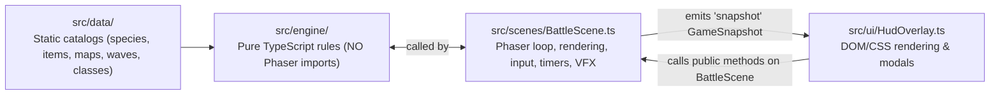

# PokéBastion TD — Developer Onboarding Guide

Welcome to **PokéBastion TD**. This guide explains how the codebase is structured, how data flows between the Phaser simulation and the DOM UI, and where to make changes safely.

---

## 1. Tech Stack & Tooling

- **Engine / Rendering:** Phaser 3 (`^3.90.0`), TypeScript (`^5.7.2`), Vite (`^6.2.0`)
- **UI:** Vanilla DOM + CSS (`src/ui/`, `src/styles.css`, `index.html`) — no React/Vue
- **Unit & Integration Tests:** Vitest (`npm test`)
- **End-to-End Tests:** Playwright (`npm run test:e2e`)
- **Linting & Formatting:** ESLint + Prettier (`husky` + `lint-staged` run them on commit)

---

## 2. Mental Model: Pure Engine + Phaser Scene + DOM HUD

The most important rule in this repository is the **three-layer split**:



1. **`src/data/`** holds static definitions and balance tables.
2. **`src/engine/`** holds **framework-free** pure TypeScript functions (A* pathfinding, damage/stat formulas, economy, meta-progression, save serialization). Because there are zero Phaser imports here, all core logic is fast to unit-test in Vitest.
3. **`src/scenes/BattleScene.ts`** owns the live game loop, grid rendering, pointer input, enemy spawning, combat ticks, audio triggers, and VFX. Whenever UI-visible state changes, it emits a `GameSnapshot` event.
4. **`src/ui/HudOverlay.ts`** (with `hudSidePanel.ts`, `hudModals.ts`, and `hudShared.ts`) subscribes to `snapshot` events, renders the HUD/modals in DOM, and forwards user actions back to public methods on `BattleScene`.

---

## 3. Directory Map

### Entry, Types & Styling

- [`src/main.ts`](../src/main.ts) — Creates the `Phaser.Game` (`Phaser.Scale.RESIZE`, `pixelArt: true`) with `[BootScene, BattleScene]`, attaches `ResizeObserver` on `#phaser-host`, and instantiates `HudOverlay`.
- [`src/types.ts`](../src/types.ts) — Shared domain types (`GameSnapshot`, `UnitState`, `EnemyState`, `StructureState`, `PlayerSave`, `EggTier`, `MapDifficulty`, etc.) and grid constants (`GRID_COLS = 28`, `GRID_ROWS = 18`, `TILE_SIZE = 32`).
- [`src/styles.css`](../src/styles.css) — Global HUD, side panel, modal, and responsive layout styles.

### Static Game Data (`src/data/`)

- [`src/data/pokemon.ts`](../src/data/pokemon.ts) — Core species definitions (`POKEMON_SPECIES`, merging `GEN1_POKEMON` + `Lucario`), `ENEMY_SPECIES`, structure specs (`STRUCTURE_SPECS`), base reward pool (`REWARD_POOL`), base wave definitions (`WAVE_DEFINITIONS`), and the legacy 3-item `HELD_ITEMS` subset.
- [`src/data/gen1.ts`](../src/data/gen1.ts) — Extended Gen 1 playable roster (`GEN1_POKEMON`, 151 species) and enemy roster (`GEN1_ENEMIES`, 151 species) merged into `POKEMON_SPECIES` and `ENEMY_SPECIES`.
- [`src/data/evolutions.ts`](../src/data/evolutions.ts) — Linear and Eevee evolution chains (`EVOLUTION_NEXT`); 3-way specialization `branches` are defined directly on `POKEMON_SPECIES` in `pokemon.ts`/`gen1.ts`.
- [`src/data/classes.ts`](../src/data/classes.ts) — 6 Pokémon classes, 18 subclasses (`CLASS_DEFINITIONS`, `SUBCLASS_DEFINITIONS`), and class/subclass minor upgrades.
- [`src/data/items.ts`](../src/data/items.ts) — Full 24-item held item catalog (`HELD_ITEM_CATALOG`) and 17 global artifacts (`ARTIFACT_CATALOG`).
- [`src/data/maps.ts`](../src/data/maps.ts) — Map layouts (`MapSpec`), terrain tiles (`waterTiles`, `treeTiles`), difficulty tiers, and map wave themes.
- [`src/data/waves.ts`](../src/data/waves.ts) — Run difficulty presets (`RUN_DIFFICULTIES`, 20–50 waves), per-map overrides (`MAP_WAVE_OVERRIDES`), and wave list builder (`getWavesForRun`).

### Pure Simulation Engine (`src/engine/`)

- [`src/engine/pathfinding.ts`](../src/engine/pathfinding.ts) — 8-directional A* (`findPath`) supporting `ground`, `burrow`, and `fly` movement types, `findUnitPath` for player Pokémon, portal placement, and no-build zone rules.
- [`src/engine/rules.ts`](../src/engine/rules.ts) — Stat/upgrade/artifact math (`getEffectiveMaxHp`, `getEffectiveAtk`, `getEffectiveStructureMaxHp`, etc.), AP movement costs, structure build/repair/sell economy, and post-wave reward rolling.
- [`src/engine/combat.ts`](../src/engine/combat.ts) — Pure combat calculations (damage, armor/DEF, crit, AoE/status helpers).
- [`src/engine/kits.ts`](../src/engine/kits.ts) — Species-specific passive kits, auras, ultimate behavior specs (`SpeciesKit`), and entry hazard definitions (`HAZARD_SPECS` for `stealth_rock`, `spikes`, `toxic_spikes`).
- [`src/engine/typeChart.ts`](../src/engine/typeChart.ts) — 18-type Pokémon elemental effectiveness chart (`POKEMON_ELEMENT_TYPES`).
- [`src/engine/progression.ts`](../src/engine/progression.ts) — Meta-progression constants & helpers: `UNLOCK_SHARD_COST`, `POTENTIAL_UPGRADE_COSTS` (★0–★5), `EGG_HATCH_RATES`, `EGG_DUPLICATE_SHARDS`, `FIRST_CLEAR_EGGS`, `REPEAT_WIN_EGG_DROP_CHANCE`, `PITY_WIN_THRESHOLD`, and `ACHIEVEMENTS`.
- [`src/engine/save.ts`](../src/engine/save.ts) — `localStorage` save/load (`PlayerSave`), shard & universal shard accounting, egg hatching (`hatchEggFromSave`), and run victory reward application (`applyRunVictoryRewards`).

### Phaser Scenes & Audio (`src/scenes/`, `src/audio/`)

- [`src/scenes/BootScene.ts`](../src/scenes/BootScene.ts) — Preloads tilesets, structures, and `public/assets/{pokemon,vfx}/manifest.json`; registers animations and generates procedural fallback textures if assets are missing.
- [`src/scenes/BattleScene.ts`](../src/scenes/BattleScene.ts) — Main gameplay orchestrator (`HOME` → `MAP_SELECT` → `DIFFICULTY_SELECT` → `DRAFT` → `PREP` → `COMBAT` → `REWARD` → `SHOP` → `VICTORY`/`DEFEAT`). Handles pointer input, live A* path previews, wave spawning, unit/enemy combat, and snapshot emission.
- [`src/scenes/terrainRenderer.ts`](../src/scenes/terrainRenderer.ts) — Tilemap and environmental prop rendering helpers extracted from `BattleScene`.
- [`src/audio/sfx.ts`](../src/audio/sfx.ts) — Web Audio / procedural SFX synthesizer.

### DOM UI (`src/ui/`)

- [`src/ui/HudOverlay.ts`](../src/ui/HudOverlay.ts) — Main HUD controller, keyboard shortcuts (`Esc`), event delegation (`data-action`), and snapshot subscription.
- [`src/ui/hudSidePanel.ts`](../src/ui/hudSidePanel.ts) — Right/side panel rendering (squad roster, unit inspector, structure tools, relics/upgrades/artifacts).
- [`src/ui/hudModals.ts`](../src/ui/hudModals.ts) — Modals for Map Select, Draft, Pokédex (shard unlocks & potential upgrades), Eggs, Rewards, and Victory/Defeat summaries.
- [`src/ui/hudShared.ts`](../src/ui/hudShared.ts) — Shared HTML escaping and UI formatting helpers.

### Assets, Scripts & Tests

- `public/assets/` — Spritesheets (`pokemon/`, `vfx/`), structures, and tilesets. Manifests (`manifest.json`) are committed in git.
- `scripts/sync-assets.mjs` & `scripts/check-bundle-size.mjs` — Asset manifest generator (for local asset pack updates) and bundle-size CI check.
- `tests/` — Vitest unit and data-integrity suites (`tests/*.test.ts`).
- `e2e/` — Playwright browser tests (`game.spec.ts`, `perf.spec.ts`).

---

## 4. Key Design Conventions

- **No per-structure upgrades:** Structures (`wood_wall`, `stone_wall`, `thorn_wall`, `flame_brazier`, `berry_bush`, `tempo_shrine`, `honey_trap`, `lightning_rod`, `barrel`) do not level up individually. Instead, structures are buffed globally by run **artifacts** (e.g., `fortification_core` in `REWARD_POOL` via `getEffectiveStructureMaxHp`).
- **Two-tier progression:**
  - _In-run:_ Draft team → place structures & held items in `PREP` → fight waves in `COMBAT` → pick upgrades/artifacts/recruits/evolutions in `REWARD`.
  - _Meta (between runs):_ Earn species shards (`RECRUIT_SHARDS`, `VICTORY_SQUAD_SHARDS`) and Eggs (`FIRST_CLEAR_EGGS`, repeat win drops/pity, `ACHIEVEMENTS`) saved via `save.ts` to unlock species and upgrade Potential (★0–★5).
- **Keep `BattleScene.ts` from growing blindly:** Put new formulas, stat modifiers, and pathing rules in `src/engine/` with unit tests first, then call them from `BattleScene.ts`.

---

## 5. Common Commands

```bash
npm install          # Install dependencies & Husky git hooks
npm run dev          # Start Vite dev server (http://localhost:5173)
npm test             # Run all Vitest unit & data-integrity tests
npm run test:e2e     # Run Playwright E2E tests
npm run build        # Type-check (tsc) and build production bundle
npm run lint         # Run ESLint
npm run format:check # Check Prettier formatting
```

> **Tip:** Whenever you add or rename a Pokémon species or VFX key in `src/data/`, run `npm test` — `tests/dataIntegrity.test.ts` verifies every key against the committed asset manifests.
